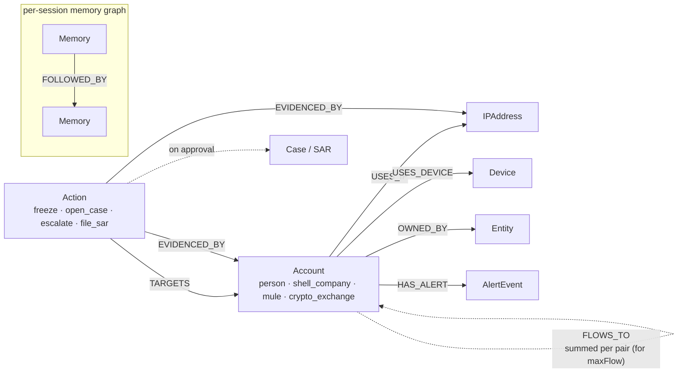
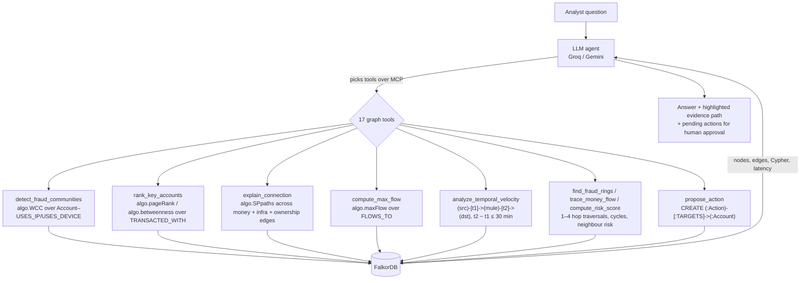

<div align="center">

# 🕵️ FraudScope AI

### An AI investigator that finds money-laundering rings by reasoning over a graph — and proposes what to do about them.

<p>
  
  
  
</p>
<p>
  
  
  
  
  
</p>

[**The graph doing the work**](#-the-graph-doing-the-work) · [**Graph model**](#️-graph-data-model) · [**Cypher & algorithms**](#-key-cypher-queries) · [**Run it locally**](#-setup--running) · [**MCP**](#-use-the-tools-from-claude-desktop-cursor-or-any-mcp-client)

</div>

---

An AI agent that investigates financial fraud by reasoning over a **FalkorDB graph database**. The graph is not a visualization layer — it **is** the intelligence. Every decision the agent makes is driven by multi-hop graph traversals, Cypher queries, and graph-propagated risk scores.

<table>
<tr>
<td align="center" width="25%"><h3>3 / 3</h3>fraud rings found by <code>algo.WCC</code><br/>with <b>no labels</b></td>
<td align="center" width="25%"><h3>100%</h3>of shell → exchange money<br/>shown as layered by <code>algo.maxFlow</code></td>
<td align="center" width="25%"><h3>21</h3>rapid mule relays caught<br/>by a temporal graph pattern</td>
<td align="center" width="25%"><h3>3–150 ms</h3>per graph tool call<br/>(2–6 s per full answer)</td>
</tr>
</table>

> **The agent never reads the answer key.** Rings, hubs, layering chains and cash-out paths are all discovered from the *shape* of the graph — shared devices, structured amounts, and how fast money moves — then every conclusion links back to the Cypher that produced it.

### Submission checklist

| Requirement | Where |
|---|---|
| README with setup instructions and graph data model | [Setup & Running](#-setup--running) · [Graph Data Model](#️-graph-data-model) |
| Cypher queries / graph algorithms the product depends on | [Key Cypher Queries](#-key-cypher-queries) · [Agent Tools](#-agent-tools-served-over-mcp) |
| Live deployment or complete local setup | Runs locally with one Docker container — see [Setup & Running](#-setup--running) (about 5 minutes) |
| Graph map: nodes, relationships, how the agent queries them | [Graph Data Model](#️-graph-data-model) · [How the agent queries the graph](#how-the-agent-queries-the-graph) |
| The graph doing the work | [The Graph Doing the Work](#-the-graph-doing-the-work) — a real investigation, step by step |

---

## 🎯 What It Does

FraudScope AI is a financial crime investigation agent that:

- **Discovers fraud rings with no labels** — `algo.WCC` community detection over shared IPs/devices, scored by structuring and internal money flow
- **Finds the key players** — `algo.pageRank` (where money concentrates) and `algo.betweenness` (brokers on the most money paths)
- **Explains how any two accounts are connected** — `algo.SPpaths` returns the shortest evidence chains
- **Quantifies layering** — `algo.maxFlow` measures how much money can reach a cash-out account through intermediaries
- **Catches rapid mule relays** — a 2-hop temporal pattern finds money that arrives and leaves an account within minutes; a time slider replays the graph
- **Ingests your own data** — upload CSV/JSON accounts, transactions and infrastructure straight into the graph
- **Acts on what the graph shows** — proposes freeze / open case / escalate / file SAR actions, stored as `(:Action)` nodes linked to their evidence; a human approves before anything changes
- **Speaks MCP** — every tool is served by a real MCP server; the in-app agent, Claude Desktop and Cursor all use the same registry
- **Streams its reasoning** — tool calls appear live in the chat and the evidence path lights up on the graph
- **Remembers what it learns** — each session gets its own isolated memory graph in FalkorDB
- **Explains every step** — shows the exact Cypher query and latency for each tool call
- **Analyst-friendly workspace** — drag the chat panel wider for long reports, adjust text size with A− / A+, wide tables scroll inside the message (both settings are remembered)

---

## 🗃️ Graph Data Model

Two kinds of graph live in FalkorDB: the shared `fraudscope` graph (accounts, money, infrastructure, actions) and one `memory_<session>` graph per investigation session.



The fraud signal is in the **shape** of this graph: mules in a ring share IPs and devices (`USES_IP` / `USES_DEVICE`), push structured amounts into a shell company (`TRANSACTED_WITH`), and the money leaves through a chain of mules to a crypto exchange within minutes.

### Node Types
| Node | Key Properties |
|------|---------------|
| `Account` | id, name, country, balance, risk_score, is_suspicious, ring_id, entity_type |
| `Entity` | id, name, type, jurisdiction |
| `IPAddress` | id, address |
| `Device` | fingerprint |
| `AlertEvent` | id, type, severity, timestamp, resolved |
| `Action` | id, type, status (PENDING_APPROVAL / APPROVED / REJECTED), reason, reviewed_by |
| `Case` / `SAR` | created when an `open_case` / `file_sar` action is approved |
| `Memory` | id, finding, timestamp, session_id, tags |

### Edge Types
| Edge | Meaning |
|------|---------|
| `TRANSACTED_WITH` | Financial transaction (has amount, currency, timestamp, channel, pattern) |
| `USES_IP` | Account accessed via this IP address |
| `USES_DEVICE` | Account accessed from this device fingerprint |
| `OWNED_BY` | Account owned by legal entity |
| `HAS_ALERT` | Account has a fraud alert event |
| `FLOWS_TO` | One edge per account pair summing its transactions (input to `algo.maxFlow`, which rejects multi-edges) |
| `TARGETS` / `EVIDENCED_BY` | Action → account it acts on / evidence that justifies it |
| `FOLLOWED_BY` | Memory chain (agent reasoning sequence) |

### How the agent queries the graph

The LLM never sees raw tables. It picks MCP tools; each tool is a Cypher query or FalkorDB algorithm over a specific part of the graph, and only the compacted result goes back to the LLM.



---

## 🔬 The Graph Doing the Work

A real run on the seeded dataset (81 accounts, 290 transactions). The agent is asked: **"Find the fraud rings and tell me what to do about them."** No ring labels are given to it; every conclusion below comes from a graph query.

| Step | Tool → graph operation | What the graph returned | Decision it drives |
|---|---|---|---|
| 1 | `detect_fraud_communities` → `algo.WCC` over shared IPs/devices | **3 clusters of 6 accounts** (5 mules + 1 shell each). Ring 1: 42 internal transactions, 37 of them between $9,000 and $9,999, $635,966 moved inside the cluster | These are rings, not coincidences: shared infrastructure **and** structuring inside the same component. All 3 match the seeded rings, found without reading `ring_id` |
| 2 | `analyze_temporal_velocity` → 2-hop `TRANSACTED_WITH` pattern with timestamps | **21 rapid relays across 13 mules**, $180,182 total, average turnaround 4.7 minutes | The mules are pass-through accounts, not victims: money leaves almost as soon as it arrives |
| 3 | `compute_max_flow` → `algo.maxFlow` from `SHELL_fec21bbe` (Phantom Holdings 1) to `CASHOUT_8de08fc2` (NovaSwap Exchange 1) | **$38,798 can reach the exchange, $0 of it directly** — 100% is layered through mules | Classic layering: the shell never pays the exchange itself, so a per-transaction rule would miss it |
| 4 | `explain_connection` → `algo.SPpaths` | Shortest chain: `SHELL_fec21bbe → MULE_0f1259e0 → CASHOUT_8de08fc2`, 2 money hops | The mule at the centre is the cash-out point; this path is highlighted on the graph and attached as evidence |
| 5 | `propose_action` → `CREATE (:Action {status:'PENDING_APPROVAL'})-[:TARGETS]->(shell)`, `-[:EVIDENCED_BY]->(mules, IPs)` | Freeze / open-case proposals in the **Actions** tab | A human approves; only then is the account frozen and a `Case` node created |

The same question against a relational table of transactions would need recursive joins for every hop and could not run community detection or max flow at all. Here, each step is one FalkorDB call that returns in milliseconds.

---

## 🔍 Key Cypher Queries

### Label-free Ring Discovery (community detection)
```cypher
CALL algo.WCC({nodeLabels: ['Account','IPAddress','Device'], relationshipTypes: ['USES_IP','USES_DEVICE']})
YIELD node, componentId
WITH componentId, collect(node) AS members
WITH componentId, [m IN members WHERE m:Account] AS accounts
UNWIND accounts AS a
OPTIONAL MATCH (a)-[t:TRANSACTED_WITH]->(b:Account) WHERE b IN accounts
RETURN componentId, count(t) AS internal_tx,
       sum(CASE WHEN t.amount >= 9000 AND t.amount < 10000 THEN 1 ELSE 0 END) AS structuring_tx
```

### Key Players (centrality)
```cypher
CALL algo.pageRank('Account', 'TRANSACTED_WITH') YIELD node, score
RETURN node.id, score ORDER BY score DESC LIMIT 10
```

### Evidence Path Between Two Accounts
```cypher
MATCH (a:Account {id: $src}), (b:Account {id: $dst})
CALL algo.SPpaths({sourceNode: a, targetNode: b,
                   relTypes: ['TRANSACTED_WITH','USES_IP','USES_DEVICE','OWNED_BY'],
                   relDirection: 'both', maxLen: 6, pathCount: 3})
YIELD path RETURN path
```

### Layering Volume (max flow)
```cypher
MATCH (s:Account {id: $src}), (t:Account {id: $dst})
CALL algo.maxFlow({sourceNodes: [s], targetNodes: [t], capacityProperty: 'amount', relationshipTypes: ['FLOWS_TO']})
YIELD maxFlow, edges, edgeFlows
RETURN maxFlow
```

### Rapid Mule Relays (temporal 2-hop pattern)
```cypher
MATCH (src:Account)-[t1:TRANSACTED_WITH]->(mule:Account)-[t2:TRANSACTED_WITH]->(dst:Account)
WHERE src.id <> dst.id AND t1.amount >= $min_amount AND t2.amount >= $min_amount
RETURN src.id, mule.id, dst.id, t1.amount, t1.timestamp, t2.amount, t2.timestamp
```
Each pair is kept when `t2` leaves within the window (default 30 minutes) after `t1` arrives; turnaround, retention (`t2 / t1`) and velocity ($/min) then grade it CRITICAL / HIGH / MEDIUM.

### Multi-hop Neighbourhood of One Account
```cypher
MATCH path = (start:Account {id: $id})-[:TRANSACTED_WITH|USES_IP|USES_DEVICE|OWNED_BY*1..4]-(connected)
WHERE connected:Account OR connected:IPAddress OR connected:Device
RETURN connected, min(length(path)) AS hops
ORDER BY hops ASC
LIMIT 100
```

### Money Laundering Chain
```cypher
MATCH (src:Account {id: $id})-[t:TRANSACTED_WITH]->(dst:Account)
RETURN dst.id, dst.risk_score, t.amount, t.channel, t.pattern
ORDER BY t.amount DESC
```

### Circular Flow Detection (Layering)
```cypher
MATCH cycle = (start:Account {id: $id})-[:TRANSACTED_WITH*2..6]->(start)
RETURN length(cycle) as cycle_length
```

### Shared Infrastructure
```cypher
MATCH (a:Account {id: $id})-[:USES_IP|USES_DEVICE]->(infra)
      <-[:USES_IP|USES_DEVICE]-(other:Account)
WHERE other.id <> $id
RETURN other, labels(infra)[0] as infra_type
```

### Graph-Propagated Risk Score
```cypher
MATCH (a:Account {id: $id})
OPTIONAL MATCH (a)-[:TRANSACTED_WITH]-(nbr:Account)
OPTIONAL MATCH (a)-[:USES_IP]->(ip)<-[:USES_IP]-(bad {is_suspicious: true})
OPTIONAL MATCH (a)-[:HAS_ALERT]->(al)
RETURN a, avg(nbr.risk_score), count(bad), count(al)
```

### Agent Memory (Per-Session Graph)
```cypher
-- Save finding
MERGE (m:Memory {id: $id})
SET m.finding = $finding, m.timestamp = $ts, m.session_id = $session

-- Recall findings
MATCH (m:Memory {session_id: $session})
RETURN m ORDER BY m.timestamp DESC
```

---

## 🏗️ Architecture

```
┌─────────────────────────────────────────────────────────┐
│                     FraudScope AI                        │
│                                                          │
│  ┌──────────┐    WebSocket/REST    ┌─────────────────┐  │
│  │  React   │◄────────────────────►│  FastAPI Server │  │
│  │  Vite    │                      │   (Python)      │  │
│  │  D3.js   │                      └────────┬────────┘  │
│  │  UI      │                               │            │
│  └──────────┘               ┌──────────────▼──────────┐ │
│                              │   Agent Loop (Gemini/   │ │
│                              │   Groq + Tool Calling)  │ │
│                              └──────────────┬──────────┘ │
│                                             │            │
│                              ┌──────────────▼──────────┐ │
│  Claude Desktop / Cursor ───►│   MCP server (/mcp/)    │ │
│                              │  17 Cypher + algo tools │ │
│                              └──────────────┬──────────┘ │
│                                             │            │
│                              ┌──────────────▼──────────┐ │
│                              │       FalkorDB          │ │
│                              │  fraudscope graph +     │ │
│                              │  memory_<session> graphs│ │
│                              └─────────────────────────┘ │
└─────────────────────────────────────────────────────────┘
```

### Why FalkorDB is Central
- **Every agent decision** goes through a graph query — no flat SQL
- **Built-in graph algorithms** (WCC, PageRank, betweenness, shortest paths, max flow) are the agent's tools
- **Actions are graph writes** — proposals, approvals, cases and SARs are nodes linked to the evidence that produced them
- **Multi-hop traversal** finds fraud rings that linear queries miss
- **Per-session memory graphs** — each investigation session is its own isolated FalkorDB graph
- **Risk propagation** runs as a graph algorithm, not a lookup
- If you replace FalkorDB with a relational DB, the agent cannot find fraud rings or propagate risk — **the graph is the product**

---

## 🚀 Setup & Running

There is no public deployment: the app needs your own LLM API keys and a FalkorDB instance, so it runs locally. The full setup takes about 5 minutes.

### Prerequisites
- Docker (for FalkorDB)
- Python 3.10+ (tested on 3.10.11)
- Node.js 18+
- A free Groq API key ([console.groq.com](https://console.groq.com)) and/or Gemini API key ([aistudio.google.com](https://aistudio.google.com)). One is enough; with both, the second is used as a fallback

### 1. Start FalkorDB
```bash
git clone https://github.com/Manasi-Choudhari/Graph_Hacks.git
cd Graph_Hacks
docker compose up -d
# OR without compose:
docker run -p 6379:6379 falkordb/falkordb:latest
```

### 2. Backend setup
```bash
cd backend
python -m venv .venv
# Windows:      .venv\Scripts\activate
# macOS/Linux:  source .venv/bin/activate
pip install -r requirements.txt
cp .env.example .env        # Windows: copy .env.example .env
```

### 3. Configure `.env`
```env
LLM_PROVIDER=groq               # or "gemini"; the other is used as fallback
GROQ_API_KEY=your_key_here
GROQ_MODEL=openai/gpt-oss-120b
GEMINI_API_KEY=your_key_here
GEMINI_MODEL=gemini-3.5-flash
FALKORDB_HOST=localhost
FALKORDB_PORT=6379
```

### 4. Run the backend
```bash
python main.py
# API:  http://localhost:8000      (check: http://localhost:8000/health)
# MCP:  http://localhost:8000/mcp/
```

### 5. Run the frontend (new terminal)
```bash
cd frontend
npm install
npm run dev
# UI: http://localhost:5173
```

### 6. Seed the graph
Click **"Seed DB"** in the UI, or:
```bash
cd backend
python seed.py
```

Then try: *"Find all fraud rings"*, *"Detect rapid mule relays"*, or *"Trace layering from SHELL_fec21bbe to CASHOUT_8de08fc2"*.

### Bring your own data (optional)
Open **Ingest Data** in the UI to upload a CSV or JSON file of accounts, transactions, IPs and devices (`append` or `replace` mode). `GET /api/ingest/template` returns the expected format, and `POST /api/ingest/sample` loads a ready-made international layering syndicate.

Seeding wipes the graph and rebuilds the same deterministic dataset every time:
- 60 legitimate accounts with 150 everyday transactions
- 3 fraud rings, each with 1 shell company + 5 mule accounts
- Structuring (transfers between $9,000 and $9,999), mule → shell collection, and a mule → mule → … → crypto cash-out layering chain per ring
- Shared IPs / devices per ring (plus a few innocent shared-WiFi pairs as noise)
- AlertEvents for all suspicious accounts

---

## 🤖 Agent Tools (served over MCP)

| Tool | Graph technique | What it finds |
|------|-----------------|---------------|
| `detect_fraud_communities` | `algo.WCC` + in-cluster money patterns | Fraud rings, without using any labels |
| `rank_key_accounts` | `algo.pageRank` / `algo.betweenness` | Collection hubs and broker accounts |
| `explain_connection` | `algo.SPpaths` | Shortest evidence paths between two accounts |
| `compute_max_flow` | `algo.maxFlow` | Money routed to a target, direct vs layered |
| `analyze_temporal_velocity` | Timestamped 2-hop pattern | Rapid pass-through mule relays, turnaround and velocity |
| `find_fraud_rings` | Multi-hop traversal (1–4 hops) | One account's ring and shared infrastructure |
| `trace_money_flow` | Directed path following + cycles | Layering, structuring, circular flows |
| `compute_risk_score` | Neighbourhood aggregation | Composite risk with propagation, account status |
| `find_shared_infrastructure` | Bipartite traversal | Shared IPs/devices (fraud signal) |
| `propose_action` | Node + edge creation | `(:Action)-[:TARGETS]->(account)`, `-[:EVIDENCED_BY]->(evidence)` |
| `list_actions` | Pattern match | Action queue with evidence |
| `get_active_alerts` | Filtered node retrieval | Open HIGH/CRITICAL alerts |
| `search_accounts` | String matching | Accounts by name, ID or entity type |
| `get_graph_overview` | Aggregation | Graph-wide statistics |
| `save_investigation_memory` / `recall_investigation_memory` | Per-session graph | Investigation memory |
| `ingest_dataset` | Batched `MERGE` / `CREATE` | Loads accounts, transactions, IPs and devices into the graph |

`review_action` (approve / reject) is deliberately **not** an MCP tool: agents propose, only a human analyst can approve, from the **Actions** tab or `POST /api/actions/{id}/review`.

### Agent modes (switcher in the chat panel)

| Mode | Endpoint | Behaviour |
|---|---|---|
| Standard | `POST /api/chat/stream` | One agent, up to 3 tool rounds; fastest (2–6 s) |
| Single agent | `POST /api/chat/stream/single` | One investigator walks through Triage → Forensics → Compliance and writes a structured report |
| Swarm | `POST /api/chat/stream/swarm` | Triage Specialist → Graph Forensics Specialist → AML Compliance Officer, each with a scoped tool set, then a combined verdict. Most thorough, but uses many more LLM calls |

---

## 🔌 Use the tools from Claude Desktop, Cursor or any MCP client

The backend serves the MCP server over streamable HTTP at `http://localhost:8000/mcp/`. For a stdio connection:

```json
{
  "mcpServers": {
    "fraudscope": {
      "command": "<path-to-repo>/backend/.venv/Scripts/python.exe",
      "args": ["<path-to-repo>/backend/mcp_server.py"]
    }
  }
}
```

Add it to Claude Desktop's `claude_desktop_config.json` or Cursor's `.cursor/mcp.json` (on macOS/Linux use `.venv/bin/python`). FalkorDB must be running.

---

## ⚡ Performance

- Graph tools return in 3–150 ms; one answer typically takes 2–6 s end to end
- Independent tools are requested in a single LLM round; findings are saved to memory automatically, without an extra LLM round
- Tool results are compacted before going back to the LLM, history is trimmed, and identical tool calls are cached for 2 minutes
- A rate-limited model is skipped for 60 s and the next model takes over for that call only; if a provider fails mid-answer, the fallback continues from the tool results already gathered
- If every LLM is rate-limited, the agent still returns the graph findings instead of an error

---

## 📸 Demo

Seed the graph, then try these prompts in order:

1. **"Find all fraud rings"** — WCC discovers the 3 rings; the graph shows them live
2. **"Who are the money hubs?"** — PageRank / betweenness highlight the key accounts
3. **"Trace layering from the top shell company to its cash-out exchange"** — max flow shows the money moved only through mules; the path lights up
4. **"Detect rapid mule relays"** — temporal velocity finds money passed on within minutes; drag the time slider to replay it on the graph
5. **"Sweep the graph and propose actions"** — proposals appear in the **Actions** tab; approving one freezes the account / opens a case in FalkorDB
6. **"What did I investigate before?"** — recalled from the session's memory graph

---

## 🏆 Hackathon Track

**Track:** Agents That Act on Connected Data

| Track 1 focus | How FraudScope AI delivers it |
|---|---|
| 🔗 **Multi-hop reasoning** | 4-hop ring traversal, shortest evidence paths, multi-hop max flow, timestamped 2-hop relay detection, three-phase single-agent and swarm investigations |
| 🧮 **Graph queries & algorithms as agent tools** | `algo.WCC`, `algo.pageRank`, `algo.betweenness`, `algo.SPpaths`, `algo.maxFlow`, temporal velocity |
| 🔌 **Tool selection through MCP** | A real MCP server (17 tools) shared by the in-app agent, Claude Desktop and Cursor |
| ⚖️ **Actions based on what the graph shows** | Evidence-linked `(:Action)` nodes; a human approves before an account is frozen or a case is opened |
| 🔍 **Explainable results** | Live tool stream, Cypher + latency per call, evidence path highlighted on the graph |

---

## 📜 Disclosure

This project was built with the assistance of AI coding tools (Antigravity IDE / Gemini, Cursor). All graph models, Cypher queries, fraud detection logic, and architecture decisions were designed and verified by the team.

---

<div align="center">

**Built for Graph Hacks — WeMakeDevs × FalkorDB · October 2026**

*If you replace FalkorDB with a relational database, this agent stops finding fraud. The graph is the product.*

</div>
